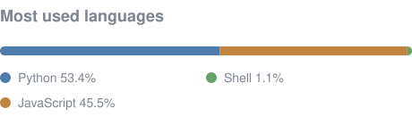

<h3 align="center">Hi, I'm BettyAnn</h3>

  <a href="https://bettyann88.com/" target="_blank" rel="noopener noreferrer">Website</a> •
  <a href="https://www.linkedin.com/in/bettyannc/" target="_blank" rel="noopener noreferrer">LinkedIn</a>

---

I build tools in Python and JavaScript, mostly with Claude Code but sometimes with local models on Apple Silicon.

Most of my professional work belongs to the companies I worked for so I cannot share it. My [website](https://bettyann88.com/) describes some of that work.

My repos here are private because they are built for other people, and their information stays with them.

A few I can describe:

- **AT Trekker:** A live Appalachian Trail map fed by a Garmin satellite tracker, with pace-adjusted arrival estimates.
- **Daily Brief:** A news brief written by a local model and delivered before 6am.
- **Resume Builder:** A local model tailors a resume and cover letter to a job posting, and every claim is traced back to a source.
- **The Watcher:** Watches Swappa and refurbished-Mac dealers for a Mac Studio M1 Ultra, keeps a price history, and alerts my phone when a good deal appears. Incorporates Ebay data, too.

---

<!-- langs:start -->

<!-- langs:end -->
